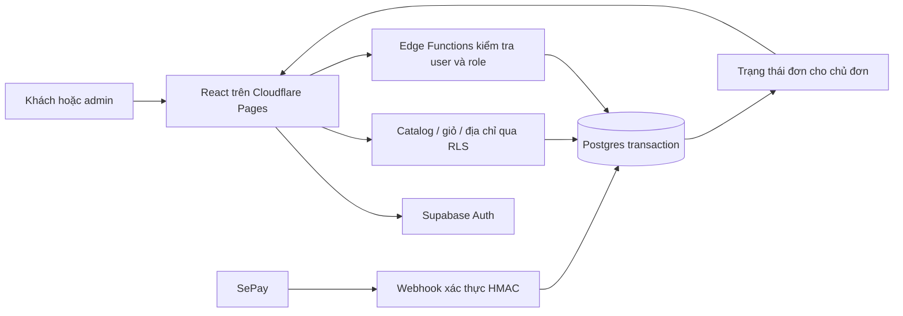

# Kiến trúc và vận hành

## Adapter local đã triển khai

Theo chỉ đạo mới, bản duyệt UI hiện dùng Node HTTP + SQLite trên 127.0.0.1:3001 và Vite trên 5173. Contract ở docs/local-api-contract.md; vận hành ở docs/setup-guide.md. Đây là adapter local để duyệt luồng và giao diện. Các phần Supabase/RLS/SePay/SMTP dưới đây vẫn là đích production chưa thực thi.

## So sánh phương án

| Phương án | Điểm phù hợp | Giả định quan trọng / giới hạn xuất hiện trước |
|---|---|---|
| React/Vite + Supabase + Cloudflare Pages | Giao diện riêng, frontend tĩnh rẻ, có auth/database/server functions | Bán thử lưu lượng nhỏ; giới hạn email, egress và việc pause DB cần theo dõi |
| Next.js SSR + backend managed | Thuận lợi SEO sản phẩm và metadata từng URL | Cần chọn host/runtime phù hợp và kiểm tra hạn mức xử lý; vận hành phức tạp hơn mức cần cho thử nghiệm |
| WooCommerce + hosting PHP | Có nhiều nghiệp vụ và plugin sẵn | Phụ thuộc hosting/plugin được bảo trì; chưa xác minh được một phương án miễn phí đáp ứng đủ yêu cầu |

Chọn phương án đầu vì người dùng ưu tiên hạ tầng miễn phí và giao diện riêng. Đánh đổi: SPA có SEO và ảnh chia sẻ theo sản phẩm hạn chế hơn SSR. Có title/meta cơ bản; không hứa thứ hạng Google hoặc preview mạng xã hội đầy đủ. Khi SEO trở thành kênh bán chính, có thể thay lớp frontend mà giữ schema và giao dịch.

Better approaches: Không tìm thấy phương án đáp ứng tốt hơn đồng thời phạm vi hiện tại và ràng buộc miễn phí; lựa chọn trên dựa vào giới hạn dịch vụ đã kiểm tra trong hồ sơ nguồn.

## Thành phần

- Cloudflare Pages: build Vite thành static assets; HTTPS và subdomain pages.dev; không chạy backend nghiệp vụ ở trình duyệt.
- React + TypeScript + React Router + Tailwind CSS; thư viện component chỉ dùng primitive trợ năng, thiết kế lại theo brief.
- Supabase Auth: email/mật khẩu, xác thực email, khôi phục mật khẩu, session; không tự viết hệ thống hash mật khẩu.
- Postgres: nguồn sự thật cho hàng, giá, tồn, giỏ, địa chỉ, đơn và tiền; giao dịch nguyên tử.
- RLS: public chỉ đọc danh mục đã xuất bản; user chỉ dữ liệu của mình; admin dựa role được server cấp.
- Storage: ảnh sản phẩm public; chỉ admin có quyền ghi; giới hạn loại file/kích thước, không chấp nhận SVG/HTML upload.
- Edge Functions: create-order, cancel-order, sepay-webhook, admin-order-action, admin-product-action; helper dùng chung tách nhỏ.
- SQL RPC: tạo đơn/giữ hàng/xác nhận tiền/chuyển trạng thái là transaction; quyền gọi tài chính chỉ backend.
- Cron trong Postgres giải phóng reservation hết hạn; checkout cũng quét reservation quá hạn liên quan trong transaction để không phụ thuộc hoàn toàn lịch nền.
- Email qua SMTP riêng của shop; thử Gmail SMTP với App Password nếu tài khoản cho phép, xác minh nhận email ngoài nhóm. Không dùng SMTP mặc định của Supabase cho mở bán.

## Luồng hệ thống

Sơ đồ này mô tả thiết kế dự kiến, chưa phải hệ thống đã triển khai.

## Dữ liệu và quyền

| Nhóm bảng | Trường/invariant chính |
|---|---|
| profiles, user_roles | profile gắn auth.users; role riêng, user không tự sửa; admin khởi tạo bằng script bảo mật |
| addresses | user_id, tên, phone, tỉnh/thành, phường/xã, chi tiết, is_default; unique mặc định theo user |
| categories, products, product_images | slug, mô tả, published, is_demo; nguồn ảnh/license; ẩn thay xóa hàng đã có đơn |
| product_variants | SKU unique, product_id, size, color, price_vnd bigint, on_hand, reserved |
| carts, cart_items | một giỏ/account; unique cart+variant; số lượng nguyên dương; không lưu giá client làm authority |
| orders, order_items | user_id, public_code unique, item/name/SKU/giá và address snapshot, phí ship, tổng VND, order_status |
| payment_intents | order_id, mã thanh toán unique, method, expected_amount, expires_at, payment_status |
| inventory_reservations | order+variant, quantity, expires_at, trạng thái; available = on_hand − reserved |
| payment_events | provider+environment+transaction_id unique, dữ kiện đối soát tối thiểu, matched order, xử lý/status |
| order_status_history, audit_logs | actor, thay đổi, thời gian, lý do; user không tự ghi log/đổi trạng thái |
| store_settings | phí ship, checkout/transfer switch, thông tin công khai; không lưu secret SePay/SMTP |

Giá, phí, tổng là số nguyên VND; không dùng floating-point. Backend tính lại tất cả từ DB. Địa chỉ và ID biến thể phải được kiểm tra quyền/tình trạng. Không cho browser UPDATE giá/tồn/paid/roles qua bảng hoặc RPC.

RPC dùng SECURITY DEFINER chỉ khi cần, khóa search_path, REVOKE EXECUTE khỏi PUBLIC/anon/authenticated đối với hàm đặc quyền. Function server xác minh user/role rồi mới truyền actor vào RPC. Service credentials chỉ nằm trong secret store. Chỉ JWT user mới xác thực người dùng; publishable key không phải danh tính.

## API dự kiến

| Giao diện | Đầu vào | Quyền / hành vi |
|---|---|---|
| create-order | cart_version, address_id hoặc địa chỉ mới, payment_method, idempotency_key | user đã xác thực; kiểm tra quote/giá/ship rồi commit snapshot và giữ hàng |
| cancel-order | order_id, reason | chủ đơn; chỉ đơn chưa xử lý/chưa nhận tiền, còn lại yêu cầu admin |
| admin-order-action | order_id, expected_version, action, reason | role admin; transition hợp lệ, audit |
| admin-product-action | sản phẩm/biến thể hoặc điều chỉnh tồn | admin; không làm on_hand thấp hơn reserved; có audit |
| sepay-webhook | raw body + header ký từ SePay | riêng endpoint này bỏ JWT gateway, bắt buộc HMAC bên trong |
| catalog/cart/addresses/order read | truy vấn theo mục đích | Supabase client với RLS; đọc đơn luôn giới hạn chủ đơn/admin |

Mã lỗi ổn định, UI Việt hóa: UNAUTHORIZED, FORBIDDEN, CART_CHANGED, OUT_OF_STOCK, ADDRESS_INVALID, PAYMENT_PENDING_REVIEW, ORDER_STATE_CONFLICT. Không lộ stacktrace hay dữ liệu người khác. Trạng thái thanh toán được đọc lại định kỳ chỉ khi tab hiển thị; dừng khi xong/hết hạn, có nút tải lại.

## Đơn, tồn kho và thanh toán

- Đặt đơn phải có idempotency key scoped theo user; cùng key/body trả cùng đơn, body khác báo conflict.
- Khóa giỏ/phiên bản trong transaction tạo đơn; chỉ xóa hoặc giảm đúng số lượng đã đặt sau khi commit. Lỗi đặt đơn giữ nguyên giỏ; thao tác thêm hàng ở tab khác không bị xóa nhầm.
- Khoá các dòng biến thể theo thứ tự cố định; kiểm tra available rồi tạo reservation cùng transaction.
- Chuyển khoản giữ hàng 15 phút (mặc định đề xuất, cấu hình được); đơn chờ và payment chờ.
- COD giữ hàng ngay; admin xác nhận trong 24 giờ (mặc định đề xuất), quá hạn hủy và hoàn reservation.
- Ngân hàng thanh toán đúng hạn: chuyển reservation thành hàng đã phân bổ bằng cách giảm on_hand và reserved cùng transaction; order trở thành đã xác nhận.
- COD: admin xác nhận thực hiện cùng bước phân bổ; trạng thái tiền vẫn chưa thu. Đã giao và đã thu tiền là hai thao tác riêng.
- Luồng đơn: pending → confirmed → packing → shipping → delivered; cancelled cho trạng thái trước shipping; trạng thái returned khi hàng đã về kho được kiểm đếm.
- Hủy trước phân bổ: thả reservation. Hủy sau phân bổ nhưng trước giao: trả on_hand đúng một lần. Hàng đã giao/đang giao chỉ tăng lại khi thực sự nhận lại hàng.
- Hủy đơn đã thanh toán: admin ghi refund_pending; tiền hoàn ngoài hệ thống, chỉ đánh dấu refunded khi có bằng chứng. Không gọi SePay để hoàn tiền khi chưa có hợp đồng API hỗ trợ.
- Race timeout/webhook/cancel được tuần tự hóa qua khóa order/reservation. Reservation đã thả thì giao dịch đến muộn luôn cần đối soát, không tự giành lại hàng.
- Thời gian thanh toán tự động xét khi server xử lý đơn còn hiệu lực; webhook đến muộn dù khách chuyển đúng giờ được đưa đối soát, có lịch sử để giải quyết.

## Hợp đồng SePay

Dùng SePay Bank Transaction Webhooks và QR chuyển khoản. Không trộn giao thức này với Payment Gateway/IPN khác của SePay.

1. Tạo payment code riêng, ngắn theo cấu trúc cấu hình SePay; không chứa email/địa chỉ. QR chứa đúng tài khoản, số tiền server tính, mã này.
2. Trong Dashboard SePay chọn đúng tài khoản nhận và sự kiện tiền vào, HMAC-SHA256, retry; không lọc bỏ giao dịch thiếu mã để admin còn đối soát.
3. Kiểm tra chữ ký trên timestamp + dấu chấm + raw body; window ±5 phút; dùng Web Crypto/HMAC phù hợp runtime, so sánh an toàn. Giới hạn payload trước parse.
4. Xác minh hướng tiền vào, tài khoản nhận, mã và số tiền. Hợp lệ không đồng nghĩa tự động matched.
5. Unique provider/environment/transaction_id; insert event và cập nhật đơn/tồn cùng một transaction. Nếu DB lỗi trả lỗi để provider retry, không đánh dấu đã xử lý trước commit.
6. Đúng số tiền và đơn đang chờ còn hạn → paid. Thiếu/thừa, sai/thiếu mã, trả hai lần, hoặc muộn → needs_review, không giao hàng tự động.
7. Request trùng đã commit → 200 success; event hợp lệ cần review cũng lưu rồi trả success. Chữ ký sai → 401. Không xác nhận tiền bằng nút “Tôi đã chuyển” ở client.
8. Tách test/live bằng project/config và event environment. Không cho sample id=0 tự tạo paid trên live.
9. Admin đối soát từ dữ kiện ngân hàng đã xác minh, ghi lý do/actor; xử lý idempotent và khóa cùng đơn. Không có nút tùy tiện sửa amount/paid.
10. Chứng minh bằng Test Mode và sau đó một giao dịch thật nhỏ do chủ shop thực hiện; chưa yêu cầu chuyển tiền trong bước plan.

## Miễn phí và vận hành thực tế

| Dịch vụ | Hướng dùng | Giới hạn đã xác minh |
|---|---|---|
| Cloudflare Pages Free | frontend tĩnh, HTTPS, subdomain | 500 builds/tháng, 20.000 file, 25 MiB/file; static requests miễn phí |
| Supabase Free | DB/Auth/Storage/Functions | DB 500 MB, storage 1 GB, egress 5 GB + cached 5 GB; có pause sau 1 tuần không hoạt động |
| SePay Free | nhận biến động và webhook | 50 giao dịch/tháng; trang giá ghi có thể vượt và tính phí vượt |
| Gmail SMTP của shop | email xác thực/khôi phục khi phù hợp | cần App Password/2FA được hỗ trợ và test deliverability; hạn mức phụ thuộc tài khoản |
| Tên miền | pages.dev trước | subdomain phụ thuộc khả dụng; chưa bao gồm mua .vn/.com |

Mục tiêu 0đ tiền hosting trong hạn mức, không cam kết tổng vận hành luôn 0đ. Phí ngân hàng/giao hàng và phí vượt SePay tách riêng. Theo dõi số giao dịch ngay trên Dashboard SePay vì chuyển khoản ngoài website cũng có thể ảnh hưởng hạn mức; công tắc tắt QR mới không ngăn được tiền người khác tự chuyển. Kiểm tra tùy chọn giới hạn vượt với SePay trước live, không tự nâng gói trả phí.

Ảnh demo tối ưu WebP và phục vụ từ Pages; ảnh admin tải lên Storage giới hạn khoảng 2 MB/file rồi tối ưu. Phân trang, không tải toàn bộ đơn/ảnh. Báo tải thất bại khi backend pause; không trả thành công giả.

Free không có backup tự động như gói trả phí: chuẩn bị script backup DB, danh sách/copy object storage, hướng dẫn bảo vệ bản sao dữ liệu; chạy trước migration và hàng ngày khi có đơn. Thử restore vào môi trường riêng. Supabase Cron xử lý thời hạn, không tạo traffic giả để né pause.

## Triển khai và khóa bí mật

- VITE_SUPABASE_URL và VITE_SUPABASE_PUBLISHABLE_KEY được phép có trên frontend; không đưa service/secret key vào VITE_*.
- SEPAY_WEBHOOK_SECRET và cấu hình nhận tiền nằm backend; SMTP password đặt trong Auth settings, không vào repo.
- SMTP dùng From đúng hộp thư shop; auth callback/redirect allowlist chỉ domain thực, không wildcard tùy ý.
- Không gửi token/password qua chat. Hướng dẫn người dùng nhập trực tiếp vào Dashboard khi triển khai.
- CORS đúng origin, CSP phù hợp, hạn chế login/reset/signup/checkout để chống lạm dụng; log có masking PII.
- Admin đầu tiên khởi tạo chủ động, không mặc định mọi người đăng ký thành admin; không tài khoản demo công khai trên live.
- Khi lỗi release: tạm ngừng checkout, rollback bản Pages trước; giữ schema tương thích, forward-fix dữ liệu khi đã có đơn mới, không restore đè DB làm mất đơn.
